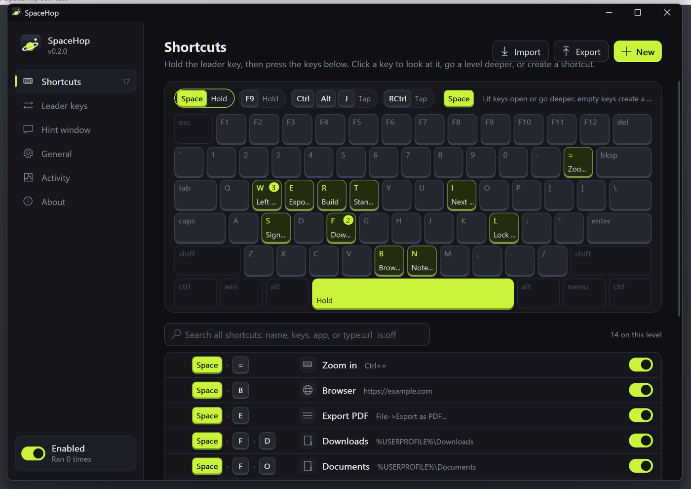
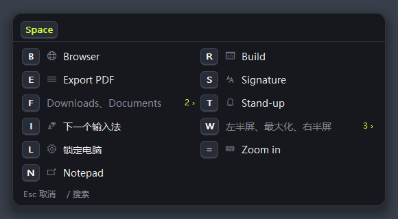

<p align="center"></p>
<h1 align="center">SpaceHop</h1>
<p align="center">Hold Space, press a key, and it is done.<br>A key-driven launcher for Windows.</p>
<p align="center"><a href="README.md">中文</a> · <b>English</b></p>

<p align="center"></p>

`Space › N` opens Notepad, `Space › F › D` opens Downloads, `Space › W › H` puts the window on the left half.
Tap Space and it types a space as always; hold it and it leads a shortcut. SpaceHop tells the two apart.

- **Small**: one executable of about 4 MB. No installer, no administrator rights, no runtime to install
- **Fast**: the keyboard hook takes under a millisecond per key; when idle it does nothing at all
- **Native**: the interface is drawn by the program itself, no web technology; Chinese / English, dark / light
- **Clean**: never goes online, never records what you type; the configuration is JSON you can read and edit

## Install

1. Download `SpaceHop-amd64.exe` from [Releases](../../releases/latest) (`SpaceHop-arm64.exe` for ARM devices).
2. Put it somewhere permanent and run it. An icon appears in the tray; the first run opens the settings window.
3. To have it start with Windows: Settings › General › Start with Windows.

Windows 10 or 11. The executable is not code-signed, so SmartScreen may warn on the first run: choose “More info › Run anyway”.

## First steps



Hold Space for about half a second and a hint window lists the keys you can press. These come built in:

| Keys | Action |
| --- | --- |
| `Space › E` | Open File Explorer |
| `Space › N` | Open or switch to Notepad |
| `Space › F › D` | Open the Downloads folder |
| `Space › W › H / L / K / J` | Window to the left half / right half / maximized / centred; can be repeated |
| `Space › Tab` | Switch to the previous window |
| `Space › ,` | Open settings |

While the hint is showing: `Esc` cancels, `Backspace` goes up a level, `/` searches every shortcut.

To create or change a shortcut, click any key on the keyboard in the settings window.

<br clear="right">

## Features

**Typing is left alone**

- A tap of Space types a space; in fast typing, the next key landing on a held Space does not trigger anything
- A key with no shortcut on it is typed as usual, together with the space
- `Shift / Ctrl / Alt / Win + Space` are untouched; hold-Space-and-drag (panning a canvas) keeps working
- Off automatically in full-screen games, and in any apps you list

**Shortcuts**

- One key, or a sequence of up to 8; several can run in a row without releasing the leader
- Each one can be limited to certain apps, or kept out of them
- Prefix actions: `Space › G` runs something while `Space › G › H` stays reachable
- After running: back to the top, stay on the level (to repeat), or end
- Conflicts are pointed out when saving: same keys in overlapping scopes, or a shorter shortcut in the way

<details>
<summary><b>Leader keys</b>: Space is only the default; four kinds can live side by side</summary>

| Kind | Example | How it works |
| --- | --- | --- |
| Hold · quick tap kept | Space, a letter | Tap to type as usual, hold for shortcuts |
| Hold · dedicated key | CapsLock, F12 | Ready on press; the key loses its original function |
| Tap · combination | Alt+S | Press and release it, then press the trigger keys |
| Tap · single modifier | Right Ctrl | Tap it alone, then the trigger keys; or run an action with no trigger key |

</details>

<details>
<summary><b>Actions</b>: twelve kinds</summary>

| Action | What it does |
| --- | --- |
| Open app | Start it, or switch to it when it is running; when already in front, go to its next window, minimize, or switch back; arguments; several apps can rotate on one key |
| Open URL | In the default browser or one you choose |
| File / folder | Optionally with an app you choose |
| Run file | Scripts, batch files, executables, with arguments |
| Run command | cmd or PowerShell, optionally without a window |
| Keystroke | Any combination; holding the trigger key repeats it |
| Insert text | Typed, or pasted with the clipboard put back; `{{cursor}}` `{{clipboard}}` `{{date}}` `{{time}}` |
| Menu command | An item of the front window's menu bar, such as `File->Save As...` |
| Window | Halves, thirds, quarters, maximize, centre, next display, custom position; switch to the previous window |
| Input method | Switch to a language's input method, or the next one |
| Notification | Shows a notification; clicking it can open a URL |
| System | Lock, sleep, display off, show desktop, pause SpaceHop |

</details>

<details>
<summary><b>Hint window and housekeeping</b></summary>

- Hint window: modern or classic style, dark, light or following Windows; drag it anywhere; adjustable delay, or off; shortcuts you know well are shown fainter
- Export and import shortcuts (merge or replace; duplicates skipped or overwritten), or copy them through the clipboard
- Every save is backed up; restore with one click in settings
- Activity log: see how each key press was judged (in memory only; what you type is not recorded)

</details>

## Configuration file

`%APPDATA%\SpaceHop\config.json`. Edit and save it; SpaceHop reloads it by itself. If the content has a problem you are told, and the previous configuration stays in use.

Next to it, `config.json.bak` is the version before the last save, and `backups\` holds dated automatic backups (the newest 30).

## Command line

While SpaceHop is running, run it again with an argument:

| Argument | Effect |
| --- | --- |
| `--settings` | Open settings |
| `--toggle` | Pause / resume (also `--enable`, `--disable`) |
| `--run "Notepad"` | Run a shortcut's action by name or id |
| `--reload` | Read the configuration file again |
| `--quit` | Quit |

## Known limits

- Does not work while the front window belongs to a program run as administrator. That is a Windows rule; running SpaceHop as administrator too lifts it.
- Menu commands need a standard menu bar. For browsers, Office, VS Code and other self-drawn interfaces, use “Keystroke”.
- Input methods can only be switched by language. With several input methods under one language, Windows offers no way to pick one directly.
- Search in the hint window matches the letters you press against names, keys and target paths. It does not go through an input method, so search Chinese names by path or keys.
- The settings window is mouse-only for now (apart from text fields and key recording) and does not support screen readers.
- No in-app update yet: replace the executable by hand.

## Build from source

Go 1.22 or newer. Builds on any system, with no other tools:

```
./build.sh
```

The executables land in `dist/`. The version lives only in the `VERSION` file.

| Directory | Contents | Needs Windows |
| --- | --- | --- |
| `internal/engine` | Deciding tap or hold, sequences, search | no |
| `internal/ui`, `internal/raster` | All logic and drawing of the settings window | no |
| `internal/win` | Keyboard hook, windows, tray, the actions | yes |

```
go test ./...                               tests of the logic, the interface and the drawing
dist\SpaceHop-amd64.exe --selftest out      a self-test that really runs on Windows
dist\SpaceHop-amd64.exe --selftest out ui   settings window only; sends no keys
```

The self-test presses real keys and checks which ones get through, photographs the hint window and every page of the settings, runs the actions against Notepad, and measures the keyboard hook and redraw times. CI builds both architectures on every commit and runs it on Windows. On a Mac, `tools/vm.sh` runs the same self-test in a Parallels virtual machine.

## Credit

Holding Space as a leader key comes from [SpaceLauncher](https://spacelauncherapp.com/) on macOS. SpaceHop is an independently written Windows program and is not affiliated with it.
