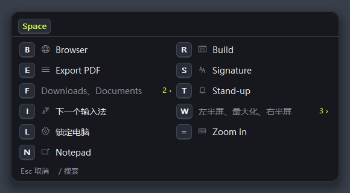

<p align="center"></p>
<h1 align="center">SpaceHop</h1>
<p align="center">按住空格，再按一个键，事情就办了。给 Windows 的按键启动器。</p>

<p align="center"></p>

`空格 › N` 打开记事本，`空格 › F › D` 打开下载文件夹，`空格 › W › H` 把窗口放到左半屏。
轻点空格照常打字，按住才是快捷键，两者自动区分。

- 一个 exe，约 8 MB，不用安装，不需要管理员权限
- 不联网，不记录输入内容
- 配置是一份可以直接读写的 JSON

## 安装

1. 从 [Releases](../../releases) 下载 `SpaceHop-amd64.exe`（ARM 设备下载 `SpaceHop-arm64.exe`）。
2. 放到一个固定的位置，双击运行。右下角托盘会出现图标，第一次运行会打开设置窗口。
3. 想让它开机就在：设置 › 通用 › 开机自动启动。

需要 Windows 10 或 11。exe 没有代码签名，第一次运行时 SmartScreen 可能提示，点“更多信息 › 仍要运行”。

## 上手

按住空格大约半秒，屏幕下方会出现提示窗，列出现在能按的键。自带的几条可以直接试：

| 按键 | 动作 |
| --- | --- |
| `空格 › E` | 打开资源管理器 |
| `空格 › N` | 打开或切换到记事本 |
| `空格 › F › D` | 打开下载文件夹 |
| `空格 › W › H / L / K / J` | 窗口放到左半屏 / 右半屏 / 最大化 / 居中，不松开空格可以连按 |
| `空格 › Tab` | 切换到上一个窗口 |
| `空格 › ,` | 打开设置 |

提示窗出现时，`Esc` 取消，`Backspace` 返回上一级，`/` 搜索全部快捷键。

在设置窗口里，点键盘图上的任意一个键就能新建或修改快捷键。

## 功能

**不妨碍打字**

- 轻点空格照常输入；快速打字时下一个键压在空格上不会误触发
- 按了没有绑定的键，两个键都照常输入
- `Shift / Ctrl / Alt / Win + 空格` 不受影响；按住空格拖动鼠标（画图软件里平移画布）照常可用
- 全屏游戏里自动停用，也可以指定在哪些程序里完全停用

**引导键**（开始一个快捷键的那个键，可以同时用多个）

| 方式 | 例子 | 说明 |
| --- | --- | --- |
| 按住 · 保留轻点 | 空格、字母键 | 轻点照常输入，按住才触发 |
| 按住 · 专用键 | CapsLock、F12 | 按下立即就绪，不再有原来的功能 |
| 轻按 · 组合键 | Alt+S | 按一下松开，再依次按触发键 |
| 轻按 · 单个修饰键 | 右 Ctrl | 单独按一下再按触发键；也可以不带触发键直接运行 |

**快捷键**

- 一个键，或最多 8 个键的序列；不松开引导键可以连续运行多个
- 每条可以限定只在某些程序里生效，或排除某些程序；同一个键在不同程序里做不同的事
- 前缀动作：`空格 › G` 运行一个动作，同时 `空格 › G › H` 仍然可用
- 运行之后可以回到顶层、停在这一层（连按）或结束
- 保存时提示冲突：相同按键、范围重叠，或被更短的快捷键挡住

**动作**

| 动作 | 说明 |
| --- | --- |
| 打开程序 | 没开就启动，开了就切过去；已在最前时切到它的下一个窗口、最小化或切回上一个程序；可以带启动参数，可以让几个程序用同一个键轮换 |
| 打开网址 | 默认浏览器或指定的浏览器 |
| 打开文件 / 文件夹 | 可以指定用哪个程序打开 |
| 运行文件 | 脚本、批处理、可执行文件，可带参数 |
| 运行命令 | cmd 或 PowerShell，可以不显示窗口 |
| 模拟按键 | 任意组合键；按住触发键会连续重复 |
| 插入文本 | 逐字键入或通过剪贴板粘贴（之后恢复剪贴板）；支持 `{{cursor}}` `{{clipboard}}` `{{date}}` `{{time}}` |
| 菜单命令 | 运行当前窗口菜单栏里的某一项，如 `文件->另存为...` |
| 窗口 | 半屏、三分之一、四分之一、最大化、居中、移到下一个显示器、自定义位置；切换到上一个窗口 |
| 输入法 | 切换到指定语言的输入法，或下一个 |
| 通知 | 弹一条通知，点击可以打开网址 |
| 系统 | 锁定、睡眠、关闭显示器、显示桌面、暂停 SpaceHop |

**提示窗**

- 现代 / 经典两种样式，深色 / 浅色或跟随系统
- 位置可以拖到屏幕任意处，按比例记住；出现前的等待时间可调，也可以关掉
- 用熟了的快捷键会显示得淡一些，突出还不熟的
- 多显示器时显示在当前窗口或鼠标所在的屏幕

**管理**

- 导出、导入快捷键（合并或替换，重复的可以跳过或覆盖），也可以经剪贴板复制
- 每次保存自动备份，可以在设置里一键恢复
- 活动记录：查看每一次按键是怎么判定的（只在内存里，不记输入内容）

## 配置文件

`%APPDATA%\SpaceHop\config.json`。直接编辑并保存即可，SpaceHop 会自动重新载入；内容有问题时会提示并继续使用原来的配置。

同一目录下的 `config.json.bak` 是上一次保存前的版本，`backups\` 里是带时间的自动备份（最近 30 份）。

## 命令行

SpaceHop 运行时，再次运行它并带上参数：

```
SpaceHop.exe --settings        打开设置
SpaceHop.exe --toggle          暂停 / 恢复（也有 --enable、--disable）
SpaceHop.exe --run "记事本"     运行一条快捷键的动作，按名称或 id
SpaceHop.exe --reload          重新读取配置文件
SpaceHop.exe --quit            退出
```

## 已知限制

- 当前窗口是“以管理员身份运行”的程序时不生效。这是 Windows 的限制；把 SpaceHop 也以管理员身份运行可以解决。
- 菜单命令只支持带标准菜单栏的程序。浏览器、Office、VS Code 这类自绘界面的程序请用“模拟按键”。
- 输入法只能按语言切换。同一种语言下装了多个输入法时，Windows 不提供直接指定其中一个的方法。
- 提示窗里的搜索按键盘字母匹配名称、按键和目标路径，不走输入法，所以中文名称要用路径或按键来搜。
- 暂时没有应用内更新，新版本需要手动替换 exe。

## 从源码构建

需要 Go 1.22 或更新，任何系统都可以构建：

```
./build.sh
```

产物在 `dist/`。图标、版本信息和清单由仓库里的工具生成，不依赖其他工具。版本号只在 `VERSION` 文件里维护。

```
go test ./...                          按键判定等逻辑的测试
dist\SpaceHop-amd64.exe --selftest out  在 Windows 上做一次真实运行的自检
```

CI 在每次提交时构建两种架构，并在 Windows 上运行自检：真实地按键、检查哪些按键被放行、截取提示窗、对记事本执行各类动作。

## 致谢

按住空格作引导键的交互来自 macOS 上的 [SpaceLauncher](https://spacelauncherapp.com/)。SpaceHop 是独立编写的 Windows 程序，与它没有关联。
