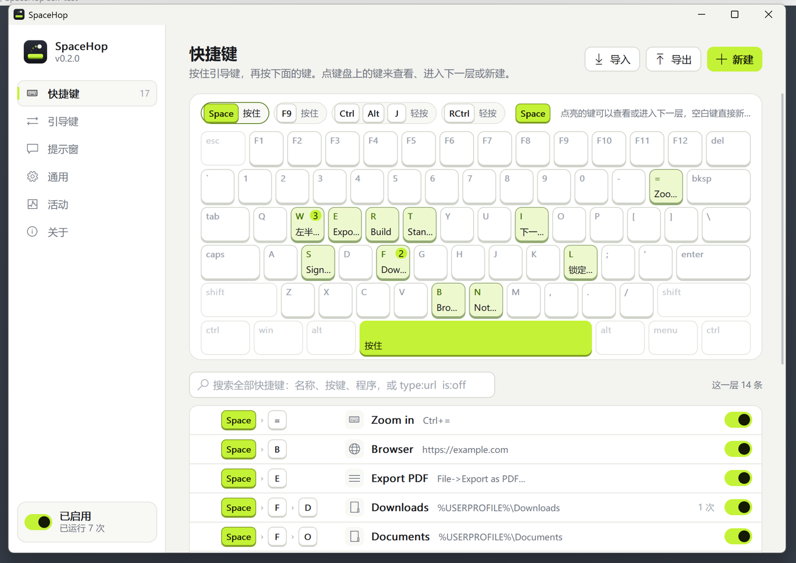
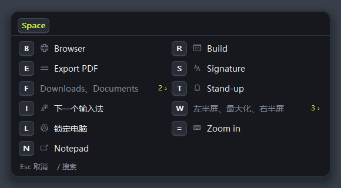

<p align="center"></p>
<h1 align="center">SpaceHop</h1>
<p align="center">按住空格，再按一个键，事情就办了。<br>给 Windows 的按键启动器。</p>
<p align="center"><b>中文</b> · <a href="README.md">English</a></p>

<p align="center"></p>

`空格 › N` 打开记事本，`空格 › F › D` 打开下载文件夹，`空格 › W › H` 把窗口放到左半屏。
轻点空格照常打字，按住才是快捷键，SpaceHop 自动区分两者。

- **小**：一个约 4 MB 的 exe，不用安装，不要管理员权限，不依赖任何运行时
- **快**：键盘钩子处理一次按键通常不到 1 毫秒；空闲时什么都不做
- **原生**：界面由程序自己绘制，不含网页技术；中文 / English，深色 / 浅色
- **干净**：不记录输入内容，只有每天一次的检查更新会联网（可以关）；配置是一份可以直接读写的 JSON

## 安装

1. 从 [Releases](../../releases/latest) 下载 `SpaceHop-amd64.exe`（ARM 设备下载 `SpaceHop-arm64.exe`）。
2. 放到一个固定的位置，双击运行。托盘会出现图标，第一次运行会打开设置窗口。
3. 想让它开机就在：设置 › 通用 › 开机自动启动。

可以在“关于”页直接更新，见[更新](#更新)。需要 Windows 10 或 11。exe 没有代码签名，第一次运行时 SmartScreen 可能提示，点“更多信息 › 仍要运行”。

## 上手



按住空格约半秒，屏幕下方会出现提示窗，列出现在能按的键。自带的几条可以直接试：

| 按键 | 动作 |
| --- | --- |
| `空格 › E` | 打开资源管理器 |
| `空格 › N` | 打开或切换到记事本 |
| `空格 › F › D` | 打开下载文件夹 |
| `空格 › W › H / L / K / J` | 窗口左半屏 / 右半屏 / 最大化 / 居中，可以连按 |
| `空格 › Tab` | 切换到上一个窗口 |
| `空格 › ,` | 打开设置 |

提示窗出现时：`Esc` 取消，`Backspace` 返回上一级，`/` 搜索全部快捷键。

要新建或修改快捷键，在设置窗口里点键盘图上的任意一个键。

<br clear="right">

## 功能

**不妨碍打字**

- 轻点空格照常输入；快速打字时下一个键压在空格上不会误触发
- 按了没有绑定的键，两个键都照常输入
- `Shift / Ctrl / Alt / Win + 空格` 不受影响；按住空格拖动鼠标（平移画布）照常可用
- 全屏游戏里自动停用，也可以指定在哪些程序里完全停用

**快捷键**

- 一个键，或最多 8 个键的序列；不松开引导键可以连续运行多个
- 每条可以限定只在某些程序里生效，或排除某些程序
- 前缀动作：`空格 › G` 运行一个动作，同时 `空格 › G › H` 仍然可用
- 运行之后可以回到顶层、停在这一层（连按）或结束
- 保存时提示冲突：相同按键且范围重叠，或被更短的快捷键挡住

<details>
<summary><b>引导键</b>：空格只是默认值，四种方式可以并存</summary>

| 方式 | 例子 | 说明 |
| --- | --- | --- |
| 按住 · 保留轻点 | 空格、字母键 | 轻点照常输入，按住才触发 |
| 按住 · 专用键 | CapsLock、F12 | 按下立即就绪，不再有原来的功能 |
| 轻按 · 组合键 | Alt+S | 按一下松开，再依次按触发键 |
| 轻按 · 单个修饰键 | 右 Ctrl | 单独按一下再按触发键；也可以不带触发键直接运行 |

</details>

<details>
<summary><b>动作</b>：十二种</summary>

| 动作 | 说明 |
| --- | --- |
| 打开程序 | 没开就启动，开了就切过去；已在最前时切到它的下一个窗口、最小化或切回上一个程序；可带启动参数；可让几个程序用同一个键轮换 |
| 打开网址 | 默认浏览器或指定的浏览器 |
| 文件 / 文件夹 | 可指定用哪个程序打开 |
| 运行文件 | 脚本、批处理、可执行文件，可带参数 |
| 运行命令 | cmd 或 PowerShell，可以不显示窗口 |
| 模拟按键 | 任意组合键；按住触发键会连续重复 |
| 插入文本 | 逐字键入，或经剪贴板粘贴后恢复剪贴板；支持 `{{cursor}}` `{{clipboard}}` `{{date}}` `{{time}}` |
| 菜单命令 | 运行当前窗口菜单栏里的某一项，如 `文件->另存为...` |
| 窗口 | 半屏、三分之一、四分之一、最大化、居中、移到下一个显示器、自定义位置；切换到上一个窗口 |
| 输入法 | 切换到指定语言的输入法，或下一个 |
| 通知 | 弹一条通知，点击可以打开网址 |
| 系统 | 锁定、睡眠、关闭显示器、显示桌面、暂停 SpaceHop |

</details>

<details>
<summary><b>提示窗与管理</b></summary>

- 提示窗：现代 / 经典两种样式，深色 / 浅色或跟随系统；位置可拖到屏幕任意处；出现前的等待时间可调，也可以关掉；用熟了的快捷键显示得淡一些
- 导出、导入快捷键（合并或替换，重复的可以跳过或覆盖），也可以经剪贴板复制
- 每次保存自动备份，可以在设置里一键恢复
- 活动记录：查看每一次按键是怎么判定的（只在内存里，不记输入内容）

</details>

## 更新

SpaceHop 大约每天向 GitHub 问一次最新版本。有新版时会弹出通知，托盘菜单里出现“更新”；点了才会安装和重启，不会自己动。更新会先下载，用发布页的 `SHA256SUMS.txt` 校验，试运行一下新程序，然后才替换；旧文件保留到新版本跑起来之后，新版本起不来就自动换回旧的。

- 只发一个普通的 HTTPS 请求到 `github.com`，不带任何关于你的信息；使用系统的代理和证书
- 在 设置 › 关于 › 自动检查更新 里可以关掉
- 程序所在的文件夹不可写（例如 `Program Files`）时会说明原因，并给出下载页
- 校验和只能防下载损坏或被篡改，防不了发布本身被入侵；exe 没有代码签名

## 配置文件

`%APPDATA%\SpaceHop\config.json`。直接编辑并保存即可，SpaceHop 会自动重新载入；内容有问题时会提示并继续使用原来的配置。

同一目录下的 `config.json.bak` 是上一次保存前的版本，`backups\` 里是带时间的自动备份（最近 30 份）。

## 命令行

SpaceHop 运行时，再次运行它并带上参数：

| 参数 | 作用 |
| --- | --- |
| `--settings` | 打开设置 |
| `--toggle` | 暂停 / 恢复（也有 `--enable`、`--disable`） |
| `--run "记事本"` | 运行一条快捷键的动作，按名称或 id |
| `--reload` | 重新读取配置文件 |
| `--quit` | 退出 |

## 已知限制

- 当前窗口是“以管理员身份运行”的程序时不生效。这是 Windows 的限制；把 SpaceHop 也以管理员身份运行可以解决。
- 菜单命令只支持带标准菜单栏的程序。浏览器、Office、VS Code 这类自绘界面的程序请用“模拟按键”。
- 输入法只能按语言切换。同一种语言下装了多个输入法时，Windows 不提供直接指定其中一个的方法。
- 提示窗里的搜索按键盘字母匹配名称、按键和目标路径，不走输入法，所以中文名称要用路径或按键来搜。
- 设置窗口目前只能用鼠标操作（输入框和按键录制除外），不支持屏幕阅读器。

## 从源码构建

需要 Go 1.22 或更新。任何系统都可以构建，不需要其他工具：

```
./build.sh
```

产物在 `dist/`。版本号只在 `VERSION` 文件里维护。

| 目录 | 内容 | 需要 Windows |
| --- | --- | --- |
| `internal/engine` | 按键判定：轻点还是按住、序列、搜索 | 否 |
| `internal/ui`、`internal/raster` | 设置窗口的全部界面逻辑和绘制 | 否 |
| `internal/win` | 键盘钩子、窗口、托盘和各类动作 | 是 |

```
go test ./...                               逻辑、界面和绘制的测试
dist\SpaceHop-amd64.exe --selftest out      在 Windows 上真实运行的自检
dist\SpaceHop-amd64.exe --selftest out ui   只检查设置窗口，不发送任何按键
```

自检会真实地按键并检查哪些按键被放行，截取提示窗和设置窗口的每一页，对记事本执行各类动作，并测量键盘钩子和重绘的耗时。CI 在每次提交时构建两种架构并在 Windows 上运行它。在 Mac 上开发时，`tools/vm.sh` 通过 Parallels 在虚拟机里运行同一套自检。

## 致谢

按住空格作引导键的交互来自 macOS 上的 [SpaceLauncher](https://spacelauncherapp.com/)。SpaceHop 是独立编写的 Windows 程序，与它没有关联。

## 许可证

[MIT](LICENSE)。
